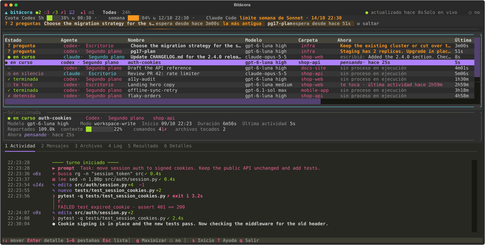
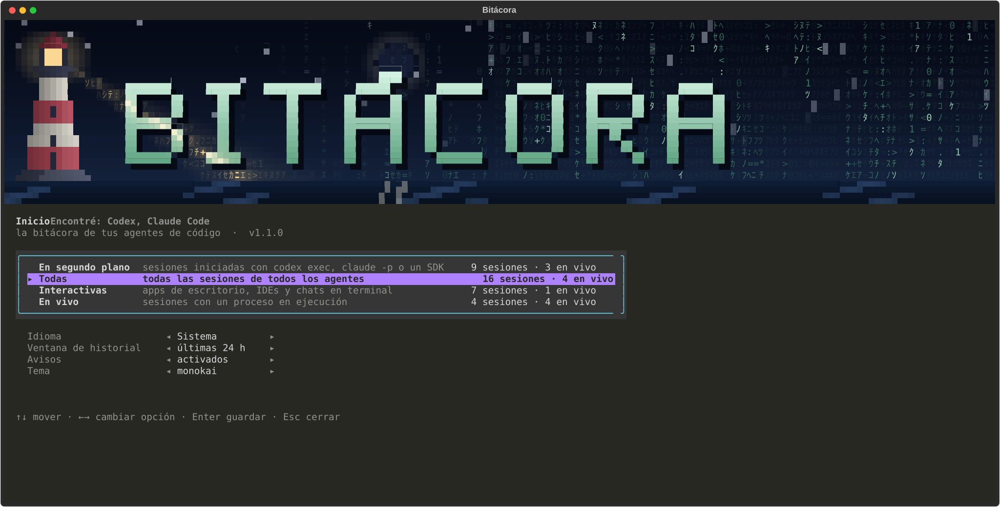

# Bitácora

[English](README.md) · **Español**

Un panel en vivo para los agentes de código que trabajan en segundo plano. Hoy funciona con Codex y Claude Code.



## Por qué

Cuando le delegas trabajo a agentes en segundo plano (un `codex exec` en otra terminal, un `claude -p` desde un script, un orquestador que lanza cinco corridas a la vez), cada uno va dejando su progreso en un archivo que nunca abres. Te enteras de cómo fue cuando termina, o cuando te acuerdas de mirar.

Bitácora lee esos archivos mientras crecen. Empareja cada proceso con su sesión y muestra qué está haciendo cada corrida, qué archivos tocó, cuánto contexto le queda y si está esperando algo de ti. No lanza agentes ni busca en tu historial: es el panel que dejas abierto mientras tus agentes trabajan.

## Qué muestra

- Cada sesión con su estado: corriendo, esperando respuesta, te toca, terminada, abortada o cortada.
- La actividad de cada sesión: comandos con su código de salida, archivos editados con líneas agregadas y quitadas, mensajes, y cuánto pensó el agente antes de cada paso.
- Pestañas para los mensajes, los archivos tocados, el log de la corrida, su archivo de resultado y todos los datos de la sesión.
- Tokens, contexto usado y, en Codex, cuánto llevas gastado de la cuota de 5 horas y de la semanal.
- Un aviso cuando una corrida termina, se corta o te pregunta algo.
- Acciones sobre la corrida seleccionada: matarla (te pide confirmación), abrir su resultado o su log, copiar el comando que la retoma.

## Instalación

```bash
uvx bitacora
```

Si prefieres dejarlo instalado: `pipx install bitacora` o `uv tool install bitacora`. Necesitas Python 3.11 o más nuevo.

En Windows también puedes descargar `bitacora.exe` desde la [última release](https://github.com/baltazarandersson/bitacora/releases/latest) y usarlo sin Python. No está firmado, así que SmartScreen te va a avisar la primera vez.

Para probarlo sin tener ningún agente instalado:

```bash
uvx bitacora --demo
```

## Uso

```bash
bitacora                      # sesiones vivas y las últimas 24 horas
bitacora --view background    # arranca en una vista y saltea la pantalla de inicio
bitacora --live               # solo sesiones vivas
bitacora --hours 72           # una ventana de historial más larga
bitacora --lang en            # interfaz en inglés
```

La primera vez, Bitácora abre su pantalla de inicio. Cada vista aparece con la cantidad de sesiones que mostraría con los datos de tu propia máquina, así sabes qué estás eligiendo antes de elegirlo. Puedes volver a esa pantalla cuando quieras con `s` para cambiar la vista, el idioma, la ventana de historial, los avisos o el tema. En terminales bajas la cabecera se pliega sola en una línea; `h` la despliega.



| Tecla | Acción |
| --- | --- |
| `↑` `↓` | Moverse entre sesiones |
| `Enter` / `Esc` | Entrar al panel de detalle / volver a la lista |
| `1`–`6` | Actividad, Mensajes, Archivos, Log, Resultado, Info |
| `PgUp` `PgDn`, `Shift+↑↓` | Desplazar el detalle desde cualquier lado |
| `v` | Detalle completo: salida de comandos, diffs, prompts enteros |
| `a` | Solo sesiones vivas |
| `f` | Pausar o reanudar el auto-scroll |
| `s` | Inicio: vistas y preferencias |
| `h` | Plegar o desplegar la cabecera (o un clic en la franja `▲ bitácora`) |
| `Ctrl+P` | Paleta de comandos: cambiar de vista o idioma, plegar la cabecera, alternar filtros |
| `k` | Matar la corrida seleccionada y sus hijos (pide confirmación) |
| `o` / `l` | Abrir el archivo de resultado / el log |
| `c` | Copiar el comando que retoma la sesión |
| `t` | Siguiente tema |
| `q` | Salir |

### Vistas

| Vista | Muestra |
| --- | --- |
| En segundo plano | `codex exec`, `claude -p` y corridas del SDK |
| Todo | Todas las sesiones de todos los agentes |
| Interactivas | Apps de escritorio, IDEs y chats en terminal |
| Solo vivas | Lo que está corriendo ahora |

Puedes sumar las tuyas en `config.toml`. `bitacora --paths` te dice dónde está ese archivo.

```toml
lang = "es"          # en, es, o no lo pongas para seguir al sistema
hours = 24           # ventana de historial
notify = true        # aviso y campana cuando una corrida termina, se corta o pregunta

[views.codex-bg]
name = "Codex en segundo plano"
providers = ["codex"]          # codex, claude
kind = "background"            # background, interactive o all
live_only = false
```

Lo que guardas en la pantalla de configuración tiene prioridad sobre `config.toml`, y los flags de la línea de comandos tienen prioridad sobre los dos.

## Cómo funciona

Bitácora solo lee archivos que los agentes ya escriben.

- **Codex**: los rollouts en `~/.codex/sessions` (o `$CODEX_HOME`), los nombres de los threads en `session_index.jsonl`, y los procesos `codex exec` / `codex` con sus flags (`-m`, `-c`, `-C`, `-s`, `-o`, `resume <id>`).
- **Claude Code**: las transcripciones en `~/.claude/projects` (o `$CLAUDE_CONFIG_DIR`) y los procesos `claude` con `--resume`, `--session-id`, `--model`, `-p`.

Cada proceso vivo se empareja con su sesión por id cuando la línea de comandos lo trae, y si no, por carpeta de trabajo y hora de inicio. El log sale de una redirección `> run.log` en la línea de comandos del shell padre. Bitácora guarda el nombre, el resultado y el log de cada sesión en su propio archivo de estado, así una corrida terminada los sigue mostrando.

## Privacidad

Todo queda en tu máquina. Bitácora no hace pedidos a la red y nunca escribe en los archivos de los agentes. Lo único que le puede hacer a un agente es matarlo, y solo después de que confirmes. Su archivo de estado guarda nombres de sesiones y rutas de archivos; `bitacora --paths` te muestra dónde.

## Límites

- Ninguno de los dos formatos está documentado, y los dos cambian entre versiones. Esta versión se probó con Codex CLI 0.161 y Claude Code 2.1.
- Donde más se usa es en Windows. En Linux y macOS pasa los tests en CI, pero tiene menos uso real.
- El razonamiento se guarda cifrado o no se guarda, así que la actividad muestra cuánto pensó el agente y no qué pensó (Codex incluye resúmenes si `model_reasoning_summary` está activo).
- Claude Code no registra su ventana de contexto, así que en sus sesiones Bitácora muestra el contexto en tokens y no en porcentaje.
- Las sesiones de subagentes todavía no se agrupan bajo su sesión madre.

## Desarrollo

```bash
git clone https://github.com/baltazarandersson/bitacora
cd bitacora
python -m venv .venv && .venv/bin/pip install -e ".[dev]"   # .venv\Scripts\pip en Windows
pytest
ruff check .
python -m bitacora --demo
python scripts/screenshot.py es    # regenera docs/*.svg a partir de la demo
```

Sumar un agente es escribir un provider en `bitacora/providers/`: dónde guarda sus sesiones, cómo se ven sus procesos y cómo convertir sus registros en eventos. El generador de la demo en `bitacora/demo.py` también sirve como fixture de los tests.

## Licencia

MIT. Bitácora es un proyecto independiente, sin relación con OpenAI ni Anthropic.
