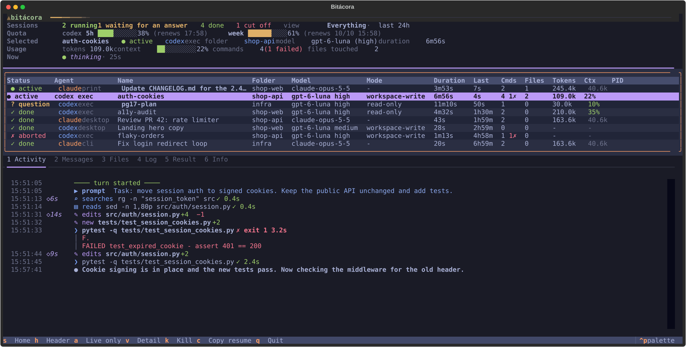
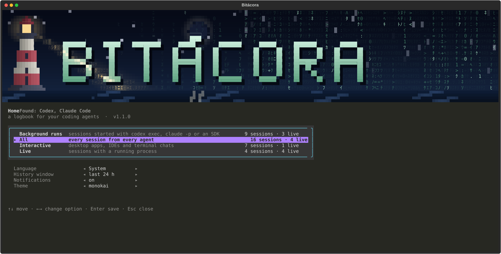

# Bitácora

**English** · [Español](README.es.md)

A live dashboard for coding agents working in the background. It supports Codex and Claude Code today.



## Why

When you hand work to agents in the background (a `codex exec` in another terminal, a `claude -p` from a script, an orchestrator that launches five runs at once), each one writes its progress to a file you never open. You find out how it went when it ends, or when you remember to look.

Bitácora reads those files while they grow. It pairs every agent process with its session and shows what each run is doing, which files it touched, how much context it has left and whether it is waiting for you. It is not a launcher and not a history search tool. It is the panel you keep open while your agents work.

## What it shows

- Every session with its status: running, waiting for an answer, your turn, done, aborted or cut off.
- An activity feed per session: commands with their exit codes, file edits with lines added and removed, messages, and how long the agent thought before each step.
- Tabs for messages, touched files, the run's log, its result file and the full session details.
- Tokens, context used and, for Codex, how much of your 5-hour and weekly quota is gone.
- A notification when a run finishes, stops or asks you something.
- Actions on the selected run: kill it (it asks first), open its result or log, copy the command that resumes it.

## Install

```bash
uvx bitacora
```

Or install it for good with `pipx install bitacora` or `uv tool install bitacora`. You need Python 3.11 or newer.

On Windows you can also download `bitacora.exe` from the [latest release](https://github.com/baltazarandersson/bitacora/releases/latest) and run it without Python. It is not code-signed, so SmartScreen will warn you the first time.

To try it without any agent installed:

```bash
uvx bitacora --demo
```

## Use

```bash
bitacora                      # live sessions plus the last 24 hours
bitacora --view background    # start in a view, skipping the setup screen
bitacora --live               # live sessions only
bitacora --hours 72           # a longer history window
bitacora --lang es            # Spanish interface
```

The first time you open it, Bitácora shows its home screen. Each view there comes with the number of sessions it would show from your own machine, so you can tell at a glance what you are choosing. You can come back to that screen anytime with `s` to change the view, language, history window, notifications or theme. On short terminals the header folds into a single line by itself; `h` brings it back.



| Key | Action |
| --- | --- |
| `↑` `↓` | Move through sessions |
| `Enter` / `Esc` | Go into the detail pane / back to the list |
| `1`–`6` | Activity, Messages, Files, Log, Result, Info |
| `PgUp` `PgDn`, `Shift+↑↓` | Scroll the detail pane from anywhere |
| `v` | Full detail: command output, diffs, complete prompts |
| `a` | Live sessions only |
| `f` | Pause or resume auto-scroll |
| `s` | Home: views and preferences |
| `h` | Fold or unfold the header (or click the `▲ bitácora` strip) |
| `Ctrl+P` | Command palette: switch view or language, fold the header, toggle filters |
| `k` | Kill the selected run and its children (asks first) |
| `o` / `l` | Open the result file / the log |
| `c` | Copy the command that resumes the session |
| `t` | Next theme |
| `q` | Quit |

### Views

| View | Shows |
| --- | --- |
| Background runs | `codex exec`, `claude -p` and SDK runs |
| Everything | Every session from every agent |
| Interactive | Desktop apps, IDEs and terminal chats |
| Live only | Whatever is running right now |

You can add your own in `config.toml`. `bitacora --paths` prints where that file lives.

```toml
lang = "en"          # en, es, or leave it out to follow the system
hours = 24           # history window
notify = true        # toast and bell when a run finishes, stops or asks

[views.codex-bg]
name = "Codex in the background"
providers = ["codex"]          # codex, claude
kind = "background"            # background, interactive or all
live_only = false
```

What you save in the setup screen takes precedence over `config.toml`, and command line flags take precedence over both.

## How it works

Bitácora only reads files the agents already write.

- **Codex**: rollouts in `~/.codex/sessions` (or `$CODEX_HOME`), thread names from `session_index.jsonl`, and the `codex exec` / `codex` processes with their flags (`-m`, `-c`, `-C`, `-s`, `-o`, `resume <id>`).
- **Claude Code**: transcripts in `~/.claude/projects` (or `$CLAUDE_CONFIG_DIR`) and the `claude` processes with `--resume`, `--session-id`, `--model`, `-p`.

A live process is matched to its session by id when the command line has one, and otherwise by working directory and start time. The log comes from a `> run.log` redirect in the parent shell's command line. Bitácora remembers each session's label, result and log paths in its own state file, so a finished run still shows them.

## Privacy

Everything stays on your machine. Bitácora makes no network requests and never writes to the agents' files. The only thing it can do to an agent is kill it, and only after you confirm. Its state file holds session labels and file paths; `bitacora --paths` shows where.

## Limits

- Neither format is documented, and both change between versions. This release was tested with Codex CLI 0.161 and Claude Code 2.1.
- Windows is where it gets the most use. Linux and macOS pass the test suite in CI, but have seen less real use.
- Reasoning is stored encrypted or not at all, so the activity feed shows how long the agent thought rather than what it thought (Codex includes summaries if `model_reasoning_summary` is on).
- Claude Code does not record its context window, so for Claude sessions Bitácora shows context in tokens instead of a percentage.
- Subagent sessions are not grouped under their parent yet.

## Development

```bash
git clone https://github.com/baltazarandersson/bitacora
cd bitacora
python -m venv .venv && .venv/bin/pip install -e ".[dev]"   # .venv\Scripts\pip on Windows
pytest
ruff check .
python -m bitacora --demo
python scripts/screenshot.py en    # regenerates docs/*.svg from the demo
```

Adding an agent means writing a provider in `bitacora/providers/`: where its sessions live, how its processes look and how to turn its records into events. The demo generator in `bitacora/demo.py` doubles as the test fixture.

## License

MIT. Bitácora is an independent project, not affiliated with OpenAI or Anthropic.
